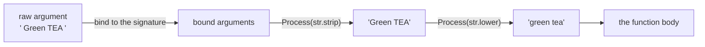

# User guide

pyargprocessors has a handful of pieces. Each page covers one of them. Every `python` block
in these docs is complete and runnable; `py` blocks are fragments.

| Piece | What it is | Page |
| --- | --- | --- |
| `Process`, `@process` | the marker, and the decorator that applies it on every call | [Process and @process](process.md) |
| `type` aliases, `process_value` | processed types named once, used anywhere | [Processed types](types.md) |
| `each`, `optional` | processors built out of other processors | [each and optional](combinators.md) |
| `process(cls)`, `@dataclass` | classes, dataclasses and named tuples | [Classes and dataclasses](classes.md) |
| a processor that raises | checking values, collecting every error of a form | [Validation](validation.md) |
| `ProcessArgumentError`, `InvalidProcessorError` | what a failure tells you | [Errors](errors.md) |
| `find_processors`, `process_arguments`, ... | for libraries that bind arguments themselves | [Building on top](building-on-top.md) |

## The mental model

1. Mark a parameter with `Annotated[<type>, Process(fn), ...]`.
2. `@process` reads the markers **once**, when the function is decorated.
3. On every call the arguments are bound to the signature, then each value that was
   **actually passed** goes through its processors, left to right.
4. The function runs with the processed values. If a processor raises, the function does not
   run and a `ProcessArgumentError` names the argument and the value.
