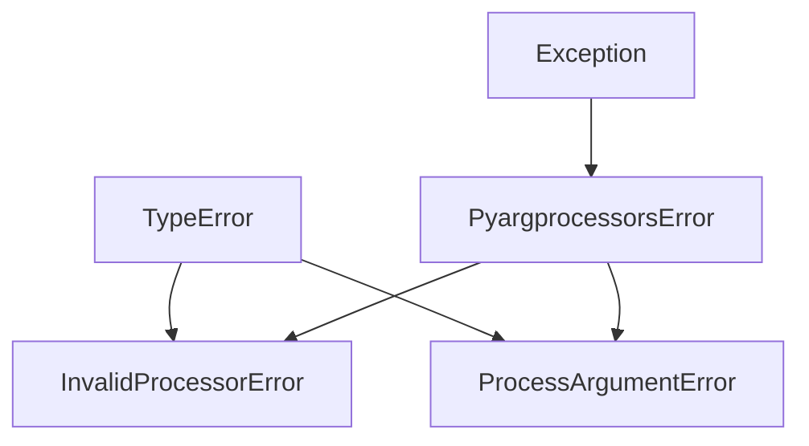

# Exceptions



Every exception derives from `PyargprocessorsError`, so callers can catch the whole family at
once, and also from `TypeError`, to stay compatible with code that expects the built-in
exception type for a bad argument.

| Exception | Raised when | Raised by |
| --- | --- | --- |
| `PyargprocessorsError` | never directly; the base class | |
| `InvalidProcessorError` | a marker cannot work: the processor is not callable, the marker is a default value, or it sits on a parameter that is not passed as an argument | `Process(...)`, `@process`, `@dataclass`, `find_processors` |
| `ProcessArgumentError` | a processor raised on a value | the decorated function or class, `process_arguments`, `process_value` |

## `ProcessArgumentError`

```py
ProcessArgumentError(argument: str, value: Any, cause: Exception)
```

| Attribute | Meaning |
| --- | --- |
| `argument` | the name of the argument; the keyword inside `**kwargs`, the parameter name inside `*args` |
| `value` | the value as it was passed, before any processor ran |
| `cause` | the exception the processor raised, also chained as `__cause__` |

`str(error)` is `Argument '<argument>' with value <value!r> failed to process, <cause>`, using
the cause's class name when its message is empty.

```python
import pickle

from pyargprocessors import ProcessArgumentError, PyargprocessorsError

error = ProcessArgumentError("limit", "two", ValueError("not a number"))

assert str(error) == "Argument 'limit' with value 'two' failed to process, not a number"
assert isinstance(error, PyargprocessorsError)
assert isinstance(error, TypeError)
assert pickle.loads(pickle.dumps(error)).argument == "limit"
```

Because it is a `TypeError`, put `except ProcessArgumentError` before `except TypeError`.

Guide: [Errors](../guide/errors.md).
